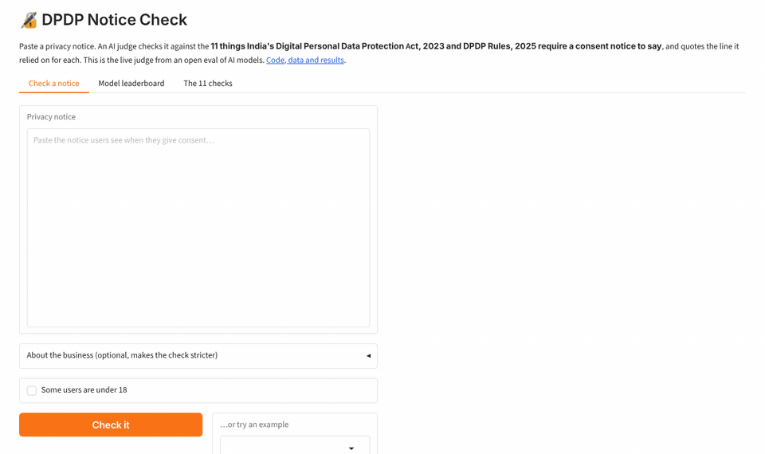
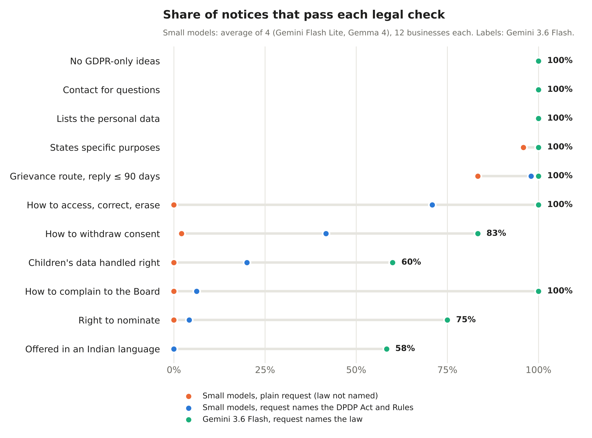

<div align="center">

# 🔏 DPDP Notice Eval

**Can AI models write a privacy notice that follows India's new data protection law?**
An open eval: 24 Indian businesses, 11 legal checks (each cited to the Act or Rules), an LLM judge that was tested against known answers before it was trusted, and a leaderboard.

[](https://github.com/NatikChhabra/dpdp-notice-eval/actions/workflows/ci.yml)
[](https://huggingface.co/spaces/Natik22may/dpdp-notice-check)
[](LICENSE)



<sub>A notice Gemini wrote for a children's clinic, checked by the judge. The judge's real output from the eval is replayed locally for the recording; the <a href="https://huggingface.co/spaces/Natik22may/dpdp-notice-check">live demo</a> calls it fresh.</sub>

</div>

## Why

India's **Digital Personal Data Protection Act, 2023** and the **DPDP Rules, 2025** (G.S.R. 846(E), notified 13 Nov 2025) say exactly what a consent notice must contain. The notice duties (Rule 3) apply from about **13 May 2027**, so Indian businesses that collect personal data need to rewrite their privacy notices before then, and many will ask an AI to do it.

YC's Fall 2026 Requests for Startups asks for [**AI-Native Compliance Infrastructure**](https://www.ycombinator.com/rfs) (Daivik Goel). That request is about financial compliance; this project applies the same idea to privacy law and asks a narrower question first: **when an AI writes a compliance document, how do you check it, at scale, in a way you can trust?** That is an eval problem.

## What I found

Across **239 notices** from the four small models (Gemini 3.1 and 3.5 Flash Lite, Gemma 4 26B and 31B), **not one passed every check**. The best met 9 of 11.

**A larger model does much better (added 9 to 11 Nov 2026).** `gemini-3.6-flash` (not a Lite model) wrote notices for all 12 core businesses. With the law named it scored **91%** (95% CI 84–96%), and **5 of its 12 notices pass every check**, the only ones in the eval that do (a bus-booking app, an insurance broker, a home-food delivery app, a public library and a gym). It names the Board in every notice, the right to nominate in 75% and the Eighth Schedule languages in 58%, which the small models almost never did. Its weakest spot is still children's data (60%). Without the law named it scored 47%, the same as the others, so a bigger model only helps once it is told which law applies. The judge is from the same model family, so treat this with some care. `gemini-3.8-flash` was meant to be added too, but on three days running the free API answered 503 and 504 errors and then reported the daily quota used up; it produced one notice, which is in the results files but not in the tables below.

<p align="center"></p>

- **Without being told about the law, every model scored 45–48%** (the small four, and 3.6 Flash). The notices list the data, the purposes and a contact, and that is about it: almost none say how to withdraw consent or how to use the rights to access, correct and erase.
- **Naming the DPDP Act and Rules helps the small models, but only up to a point: 56–65%.** Withdrawal and the rights improve a lot for three of the four. Three duties stay almost untouched: the option to read the notice in an Indian language (**0%** for all four), the right to nominate someone (**0–8%**), and how to complain to the Data Protection Board (**0–17%**). With children's data, the most a model managed was 40%.
- **One line in my own prompt was hiding this.** My first "names the law" prompt also said *"use only the facts below; don't invent other data or purposes"*. Grepping the outputs suggested that models read it as "leave out anything not in the facts", including the Board and nomination. With that line, scores fall back to 47–50%, the same as not naming the law at all. So the main result uses the prompt without it, and the old one is kept as a comparison.

Best model: **`gemini-3.6-flash` at 91%** when the law is named. Among the four small models the best is `gemini-3.5-flash-lite` at 65% (95% CI 59–70%), but the differences between them are small, and Flash Lite is also the judge, so treat its place with care: its confidence interval overlaps the next two. Model size matters far more than which small model you pick.


## What it measures

Each model gets the facts of a business (what data it collects, why, who the privacy contact is, whether children use it) and is asked to write the consent notice. Three versions of the request:

- **plain**: "write the privacy notice we show users when they sign up", plus "use only the facts below". The law isn't named. Does the model know an Indian business needs a DPDP notice?
- **names the law** (the main result): the same request, without "use only the facts", plus "it must comply with India's DPDP Act, 2023 and DPDP Rules, 2025". Does the model know what the law requires?
- **names the law + "use only the facts"** (comparison): my first design. It turned out to suppress required content, so it is kept to show the effect (see [What I found](#what-i-found)).

Every notice is scored on these checks (the children check applies only to the 7 businesses with users under 18):

| Check | What the law asks | Source |
|---|---|---|
| Lists the personal data, item by item | an itemised description of the personal data | Act s.5(1)(i); Rules r.3(b)(i) |
| States specific purposes | specified purposes and the goods/services they enable | Act s.5(1)(i); Rules r.3(b)(ii) |
| Explains how to withdraw consent | how to withdraw, as easily as consent was given | Act s.6(4), s.5(1)(ii); r.3(c)(i) |
| Explains the rights to access, correct and erase | how to exercise the rights under the Act | Act ss.11–12; r.3(c)(ii), r.14(1) |
| Mentions the right to nominate | nominate someone to act on death or incapacity | Act s.14; r.14(4) |
| Grievance route with a reply time ≤ 90 days | how to raise a grievance, and the reply period | Act s.13; r.14(3) |
| Explains how to complain to the Data Protection Board | the manner of complaining to the Board | Act s.5(1)(iii); r.3(c)(iii) |
| Contact for a DPO or a person who can answer questions | business contact information | Act s.8(9), s.6(3); r.9 |
| Offers the notice in English or an Indian language | option to read it in English or an Eighth Schedule language | Act s.5(3) |
| Doesn't import foreign-law ideas | no GDPR "legitimate interests", "data portability", "supervisory authority"… | Act ss.4, 7, 11–14, 18 |
| Handles children's data correctly | verifiable parental consent for under-18s; no tracking or targeted ads | Act s.2(f), s.9; r.10 |

The rubric only covers what the law says a *notice* must contain. It does not judge whether the processing itself is lawful, and it gives no credit for extra content.

## Can the judge be trusted?

An LLM judge is only useful if it agrees with the right answer. So before judging any model, each candidate judge was tested in three ways:

1. **Synthetic notices with known answers** (`dpdp_eval/data/validation/`). Notices are built from sections. For each check we pick a compliant section or a realistic mistake: a vague data list, a 120-day reply period, "the relevant supervisory authority", withdrawal only by registered post, children defined as under 13, personalised ads for children, and so on. The correct verdicts follow from the choices. The set is split by business: **dev** (4 businesses, 20 notices) was used to pick the judge, **test** (8 businesses, 40 notices) was held out.
2. **Real notices, hand-labelled** (`dpdp_eval/data/validation/real_labels.jsonl`). Real model notices were labelled by hand. Most were labelled before any judge saw them; the last 7 were labelled after a judge had run, without looking at its verdicts (see the commit history and [the labelling rules](docs/labelling.md), which also disclose two corrections).
3. **Quote checking.** For every check the judge must quote the line it relied on. The code then confirms the quote exists in the notice, which catches a judge inventing support for a "pass". In the main run, 2 of the 1,167 quoted passes were not found word for word in their notice (paraphrases). An early version of this check wrongly flagged bulleted lists quoted as one line; it was fixed and re-run on the stored verdicts with `python -m dpdp_eval recheck-quotes`.

| Judge | Synthetic dev (20 notices) | Synthetic held-out test (40 notices) | Real notices, hand-labelled (23) |
|---|---|---|---|
| **`gemini-3.5-flash-lite`** (chosen) | 99.0% agreement, κ 0.98 | **98.8%, κ 0.98** | **96.7%, κ 0.93** |
| `gemma-4-31b-it` (open weights; second judge) | 100%, κ 1.00 (16 of 20 notices; the free API returned errors on 4) | not run (free quota) | 95.0%, κ 0.90 (15 of 23 notices; the rest hit API errors) |
| Keyword baseline (no AI) | 95.6%, κ 0.91 | 97.8%, κ 0.96 | 92.5%, κ 0.85 |

Agreement is over every (notice, check) pair; κ is Cohen's kappa, which corrects for agreement by chance. Full tables, including every disagreement, are in [`results/judge_validation/`](results/judge_validation/).

Where the judges differ is the interesting part. On the children's-data check in real notices, the keyword baseline was right **1 time in 10**, and Flash Lite was right **10 in 10**. Withdrawal and the rights are where every judge struggles (Flash Lite 83% on each, and it is more lenient than my labels on the rights), because "you can withdraw consent at any time" with no stated method is a borderline case even for people.

Flash Lite was chosen because it was the most accurate judge that finished every notice, and because its free quota (500 requests a day) can cover the whole eval. 3.6 and 3.8 Flash get only 20 a day, and Gemma's free API often answered "500" or "503".

**Why not just use keywords?** A keyword checker (`dpdp_eval/baseline.py`) scores almost perfectly on the synthetic set, because the same person wrote both the templates and the keywords. On real notices it falls apart exactly where the law is subtle. It passes "you may withdraw consent at any time" even when the notice never says *how*. It also passes a children's section that mentions parents and the age of 18 but says nothing about tracking or targeted ads. This was the most useful lesson of the project: **a synthetic test set you wrote yourself flatters simple methods, so you need real, hand-labelled outputs to see the difference.**

## Leaderboard

**Core set: 12 businesses, every model.** Score = share of applicable checks passed. 95% CI from a bootstrap over businesses. Columns on the right are pass rates per check.

**Prompt: plain request (no law named)**

| model | notices | score | 95% CI | fully compliant | data | purpose | withdraw | rights | nominate | grievance | Board | contact | language | no GDPR | children |
|---|---|---|---|---|---|---|---|---|---|---|---|---|---|---|---|
| `gemini-3.1-flash-lite` | 12 | **48%** | 46%–50% | 0% | 100% | 100% | 8% | 0% | 0% | 92% | 0% | 100% | 0% | 100% | 0% |
| `gemini-3.6-flash` | 12 | **47%** | 46%–49% | 0% | 100% | 92% | 0% | 0% | 0% | 100% | 0% | 100% | 0% | 100% | 0% |
| `gemini-3.5-flash-lite` | 12 | **47%** | 44%–49% | 0% | 100% | 100% | 0% | 0% | 0% | 83% | 0% | 100% | 0% | 100% | 0% |
| `gemma-4-26b-a4b-it` | 12 | **46%** | 43%–48% | 0% | 100% | 92% | 0% | 0% | 0% | 83% | 0% | 100% | 0% | 100% | 0% |
| `gemma-4-31b-it` | 12 | **45%** | 42%–48% | 0% | 100% | 92% | 0% | 0% | 0% | 75% | 0% | 100% | 0% | 100% | 0% |

**Prompt: request names the DPDP Act and Rules**

| model | notices | score | 95% CI | fully compliant | data | purpose | withdraw | rights | nominate | grievance | Board | contact | language | no GDPR | children |
|---|---|---|---|---|---|---|---|---|---|---|---|---|---|---|---|
| `gemini-3.6-flash` | 12 | **91%** | 84%–96% | 42% | 100% | 100% | 83% | 100% | 75% | 100% | 100% | 100% | 58% | 100% | 60% |
| `gemini-3.5-flash-lite` | 12 | **65%** | 59%–70% | 0% | 100% | 100% | 58% | 75% | 8% | 100% | 17% | 100% | 0% | 100% | 40% |
| `gemma-4-31b-it` | 12 | **61%** | 58%–63% | 0% | 100% | 100% | 50% | 83% | 0% | 100% | 0% | 100% | 0% | 100% | 0% |
| `gemini-3.1-flash-lite` | 12 | **60%** | 54%–65% | 0% | 100% | 100% | 58% | 67% | 8% | 92% | 0% | 100% | 0% | 100% | 0% |
| `gemma-4-26b-a4b-it` | 12 | **56%** | 52%–60% | 0% | 100% | 100% | 0% | 58% | 0% | 100% | 8% | 100% | 0% | 100% | 40% |

**Prompt: names the law and adds 'use only the facts below' (comparison)**

| model | notices | score | 95% CI | fully compliant | data | purpose | withdraw | rights | nominate | grievance | Board | contact | language | no GDPR | children |
|---|---|---|---|---|---|---|---|---|---|---|---|---|---|---|---|
| `gemma-4-26b-a4b-it` | 12 | **50%** | 47%–53% | 0% | 100% | 100% | 8% | 8% | 0% | 100% | 0% | 100% | 0% | 100% | 0% |
| `gemini-3.5-flash-lite` | 12 | **50%** | 48%–52% | 0% | 100% | 100% | 17% | 0% | 0% | 100% | 0% | 100% | 0% | 100% | 0% |
| `gemma-4-31b-it` | 12 | **50%** | 47%–52% | 0% | 100% | 100% | 25% | 0% | 0% | 92% | 0% | 100% | 0% | 100% | 0% |
| `gemini-3.1-flash-lite` | 12 | **47%** | 45%–49% | 0% | 100% | 100% | 0% | 0% | 0% | 92% | 0% | 100% | 0% | 100% | 0% |

The full tables, including the 24-business set for the models with enough free quota, are in [`results/leaderboard-gemini-3.5-flash-lite.md`](results/leaderboard-gemini-3.5-flash-lite.md). Every verdict, with the judge's quote and reasoning, is in [`results/judgments-gemini-3.5-flash-lite.jsonl`](results/judgments-gemini-3.5-flash-lite.jsonl).

## Run it

```bash
git clone https://github.com/NatikChhabra/dpdp-notice-eval && cd dpdp-notice-eval
pip install -r requirements-dev.txt
pytest                                                    # 33 tests, no API key needed
python -m dpdp_eval validate-judge --judge baseline --split test

export GEMINI_API_KEY=...                                  # free key from Google AI Studio
python -m dpdp_eval validate-judge --judge gemini-3.5-flash-lite --split test
python -m dpdp_eval generate --models gemma-4-31b-it --core
python -m dpdp_eval judge --judge gemini-3.5-flash-lite
python -m dpdp_eval report --judge gemini-3.5-flash-lite
python app.py                                             # the demo, at http://127.0.0.1:7860
```

Every model call is appended to a JSONL file as soon as it returns, so a run that hits the free daily quota stops cleanly and resumes from the same point next time. Every model call behind `results/` was made by the [`run eval`](.github/workflows/run-eval.yml) GitHub Action, which uses the API key stored as a repository secret and commits its outputs, so every verdict can be traced to a logged run. The tables and the quote re-check are computed from those stored outputs and can be rebuilt offline (`report`, `recheck-quotes`).

| AI engineering skill | Where it is |
|---|---|
| Designing a rubric from a legal text | `dpdp_eval/rubric.py` |
| LLM-as-judge with structured output (evidence → reasoning → verdict) | `dpdp_eval/judge.py` |
| Validating a judge: known-answer set, dev/test split, hand labels, Cohen's kappa | `dpdp_eval/synth.py`, `cli.py validate-*`, `metrics.py` |
| Catching hallucinated evidence | `judge.evidence_found` |
| Prompt-injection guard (the notice is untrusted input) | `JUDGE_SYSTEM` in `judge.py` |
| Bootstrap confidence intervals, clustered by business | `metrics.bootstrap_ci` |
| Finding and fixing a confound in my own prompt | `CONDITIONS` in `scenarios.py` |
| Working inside tiny free-tier rate limits (pacing, resume, per-model files) | `llm.py`, `cli.py` |
| Testing LLM code without API calls | `tests/` (a fake model) |

## Limits (please read)

- **Not legal advice.** It checks the minimum content the Act and Rules require in a notice, as read by the author. Courts and the Data Protection Board have not interpreted these rules yet.
- **Small and synthetic.** 24 made-up businesses, and only the models a free Gemini API key can reach (Gemini 3.1 and 3.5 Flash Lite, and open-weight Gemma 4; Gemini 3.6 Flash allows only 20 requests a day, so it has the 12-business core set only, and 3.8 Flash could not be run). Frontier "Pro" models are not on the free tier, so they aren't here.
- **The judge is a Google model judging Google models.** Self-preference is a known LLM-judge bias. The hand-labelled real notices and a second judge from a different model family (Gemma, open weights) are there to show how much it matters; see the judge table.
- **The hand labels were made by Claude** (the AI that helped build this) under the rules in `docs/labelling.md`, written before the judges ran. No lawyer has checked them. Even two lawyers would disagree on some borderline cases, such as whether "manage your settings" counts as a way to withdraw consent.
- **The synthetic judge-test set is easy.** It is templated, so near-perfect scores on it mean little alone. The real-notice numbers matter more.
- **Phrasing matters.** Results are for three fixed prompts, and the comparison above shows how much one line can change them. A founder who pastes the full text of the Rules may well get better notices; that was not tested.

## Built with AI, openly

I built this with **Claude (Anthropic) as a coding and research partner**. Claude wrote most of the code under my direction. I chose the problem, the legal scope and the quality bar. Every check cites the section of the Act or Rules it comes from, so anyone can verify it against the source. The models being tested and the judge are Google's Gemini and Gemma, run on a free API key.

Built by [Natik Chhabra](https://github.com/NatikChhabra). The previous tool in the same series is [RTI Sahayak](https://github.com/NatikChhabra/rti-sahayak), which writes and checks Right to Information applications. MIT licence · Legal text used (Gazette copies, via dpdpa.com): [DPDP Act, 2023](https://dpdpa.com/DPDPA_2023_official.pdf) (Act No. 22 of 2023) · [DPDP Rules, 2025](https://dpdpa.com/DPDP_Rules_2025_English_only.pdf) (G.S.R. 846(E), 13 Nov 2025)
